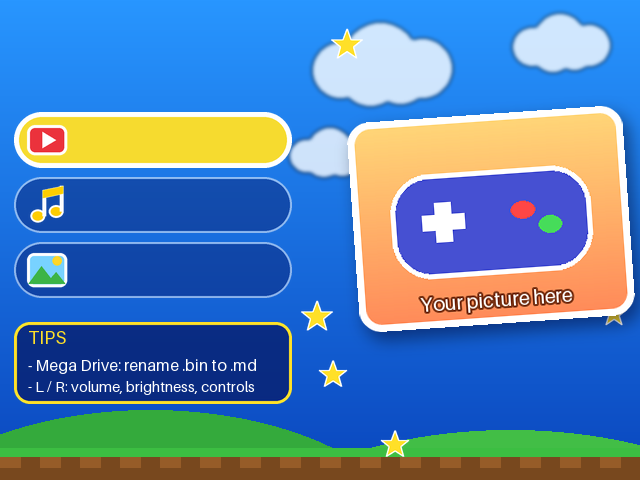
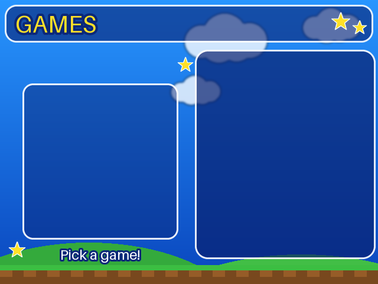
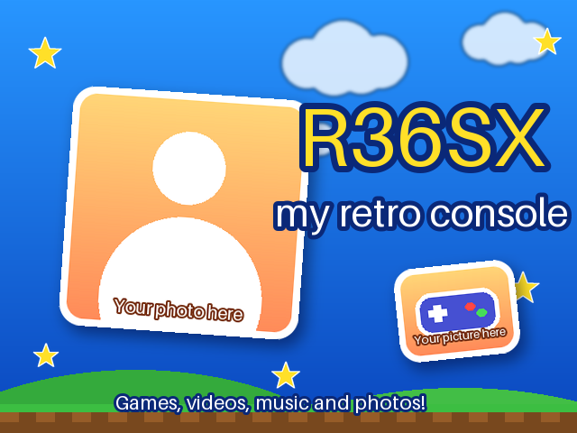
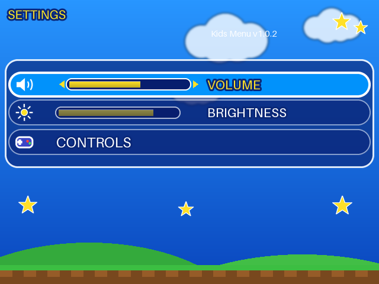

# R36SX Kids Menu 🎮

**Um menu simples, colorido e feito para crianças para os clones baratos do console retrô "R36S / R36SX" (HiChip HC1600A, firmware `cubegm`).**
Só quatro botões grandes – **Jogos · Vídeos · Músicas · Fotos** – com suas cores, seus textos, a foto do seu filho na tela de abertura e alguns extras úteis.

🇬🇧 [Read in English](README.md)

| Menu principal | Jogos | Tela de abertura |
|---|---|---|
|  |  |  |



> As imagens acima são os **placeholders** (imagens de exemplo) que já vêm no projeto. Você troca pelas suas em um minuto.

> ⚠️ **Status: versão inicial (v1.0.2).** O menu, as alterações de código e a ferramenta foram testados em **um** console real (clone R36SX V2.6, HiChip HC1600A). A *ferramenta de build* e os pacotes com imagens de exemplo foram verificados no PC e a estrutura dos arquivos bate com a original, mas os pacotes **ainda não foram executados num console**. Por favor teste e [abra uma issue](../../issues) com o resultado (funcionou / não, e o seu modelo). Mantenha um backup do cartão SD.

## O que você ganha

- 🧒 Menu reduzido a **Jogos / Vídeos / Músicas / Fotos**, mais uma página simples de **Ajustes** só com **volume, brilho e controles** (mapeamento de teclas por console). Idioma, tamanho da tela, restaurar de fábrica, e-books e lista de consoles ficam ocultos.
- 🎨 **Suas cores, textos e idioma** (Português ou English; para outro idioma basta copiar um arquivo de textos) – tudo em um arquivo simples, o `config.toml`.
- 🖼️ **Sua foto** na tela de abertura e um **mascote/logo** nos menus. Sem imagem? Usa uma imagem desenhada.
- ▶️ **Volta ao jogo que estava rodando**: se você desligar o aparelho *jogando*, ele reabre esse jogo ao ligar. Se saiu do jogo antes (ou segurou **B** ao ligar), liga no menu.
- 🗑️ **Tecla X exclui um jogo** – apaga o jogo, os arquivos do `.cue`, os de mesmo nome e a capa (pergunta antes).
- 💾 **Tecla X exclui um save** nas telas Carregar/Salvar do menu de pausa.
- 🙈 Arquivos `.bin` escondidos da lista (jogos de PlayStation abrem pelo `.cue`).
- 🖼️ **Capas** em `roms/images/<nome do jogo>.png` (240×240), com imagem "sem capa" para jogos sem capa.
- ⚡ Ajuste opcional do PlayStation (iluminação e contador de FPS desligados).

## Início rápido (3 passos, sem programar)

> ⚠️ **Faça antes uma cópia de segurança do cartão SD.** Sempre.

**Opção A – pacote pronto (mais rápido).** Baixe o zip do seu idioma na página de [Releases](../../releases/latest), abra, copie as pastas `cubegm` e `roms` para o cartão SD (responda *Substituir/Mesclar*). Pronto.

**Opção B – montar do seu jeito (suas cores, foto e textos):**

1. Instale o [Python 3.11+](https://www.python.org/downloads/) (marque **"Add python.exe to PATH"**).
2. Copie a pasta **`cubegm`** do seu cartão SD (firmware original) para a pasta **`stock`** deste projeto. Coloque suas imagens em **`my_files`**. Abra o **`config.toml`** no Bloco de Notas e mude o que quiser.
3. Dê dois cliques em **`build.bat`** (Windows) ou rode `./build.sh` (Linux/macOS). Veja as imagens em `output/preview` e copie o conteúdo de **`output`** para a raiz do cartão (*Substituir/Mesclar*).

📖 Guia completo passo a passo, com todas as opções: **[docs/pt-BR/GUIA.md](docs/pt-BR/GUIA.md)**

## Meu aparelho é compatível?

Foi feito e testado **em um único aparelho** (clone "R36SX V2.6" com chip HiChip HC1600A, Linux 4.4, programa `rkgame`). As alterações de código só se aplicam ao `rkgame` original exato para o qual foram escritas; qualquer outro arquivo é **recusado** e nada é alterado. Confira o seu em 10 segundos:

```bash
python build.py --check
```

Detalhes e como relatar um modelo novo: [docs/pt-BR/COMPATIBILIDADE.md](docs/pt-BR/COMPATIBILIDADE.md).

## Documentação

| | English | Português |
|---|---|---|
| Guia passo a passo, personalização, problemas | [GUIDE](docs/en/GUIDE.md) | [GUIA](docs/pt-BR/GUIA.md) |
| Compatibilidade | [COMPATIBILITY](docs/en/COMPATIBILITY.md) | [COMPATIBILIDADE](docs/pt-BR/COMPATIBILIDADE.md) |
| Como funciona (para curiosos) | [HOW-IT-WORKS](docs/en/HOW-IT-WORKS.md) | [COMO-FUNCIONA](docs/pt-BR/COMO-FUNCIONA.md) |
| Notas legais | [LEGAL](docs/en/LEGAL.md) | [LEGAL](docs/pt-BR/LEGAL.md) |

## Contribuir

Novo idioma? Copie `r36skit/data/strings/en.json` para, por exemplo, `es.json`, traduza os valores e use `language = "es"`. Pull requests e relatos de compatibilidade são bem-vindos. Rode os testes com `python -m pytest`.

## Licença

Código: [MIT](LICENSE). Este projeto **não tem vínculo** com nenhum fabricante de console. O firmware do aparelho pertence ao fabricante – veja [LEGAL](docs/pt-BR/LEGAL.md). Use por sua conta e risco.
